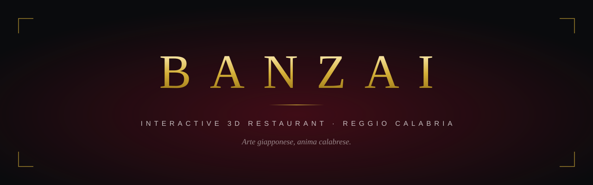

 

**An interactive 3D digital twin of a sushi and burger restaurant on the Lungomare of Reggio Calabria.** 
Guests explore the room, open the menu on the table, build a plate and book, all in the browser.

 

<!-- LIVE URL: replace the badge below with  once deployed -->

Client project &middot; closed source &middot; this repository is a presentation only

---

## The brief

Banzai is a restaurant on the seafront of Reggio Calabria, serving sushi, gourmet burgers, wood-fired pizza and Happy Hour cocktails. The brief was a website that feels like walking in: the venue rebuilt in 3D, its real menu inside it, and a booking that reaches the staff on WhatsApp in one tap.

<!-- SCREENSHOT: hero view, the palazzo at night from the Lungomare. Save as assets/hero.jpg (1600x900) and replace this comment with:

-->

---

## The experience

<table>
<tr>
<td width="50%" valign="top">

### Cinematic arrival
A split-screen opening, sushi with rising steam on one side and wood-fired pizza with drifting embers on the other, under a gold-rimmed glass card. A crimson-to-gold ring tracks every texture and photo as it loads. At 100 % the screen fades by itself and the camera glides down onto the street.

</td>
<td width="50%" valign="top">

<!-- SCREENSHOT: assets/splash.jpg -->

</td>
</tr>
<tr>
<td width="50%" valign="top">

<!-- SCREENSHOT: assets/maquette.jpg -->

</td>
<td width="50%" valign="top">

### The Dark Maquette
The neighbourhood around the restaurant is built as an architect's model in near-black stone: matte facades a few shades apart, a solid dark ground with no tiling, and a deep metallic sea that catches the sky. The restaurant is the only warm light in the scene, so it is the first thing you see.

</td>
</tr>
<tr>
<td width="50%" valign="top">

### The Glass Annex
A glass conservatory added behind the historic palazzo: clear glass with real refraction, black steel mullions and warm light lines. You reach it through an opening cut in the back wall, and it holds six dining tables.

</td>
<td width="50%" valign="top">

<!-- SCREENSHOT: assets/glass-annex.jpg -->

</td>
</tr>
<tr>
<td width="50%" valign="top">

<!-- SCREENSHOT: assets/menu.jpg -->

</td>
<td width="50%" valign="top">

### Menu, plate and booking
Tap the leather menu book on a table to open the real menu. Dishes and drinks turn in 3D, with a pairing suggested for each one. The plate builder assembles a custom pizza or sushi step by step and sends the order to the table. Bookings go to the restaurant's system and, if the guest wants, to the staff on WhatsApp.

</td>
</tr>
</table>

---

## Highlights

| | |
|---|---|
| **Seven languages** | Italian, English, French, German, Japanese, Chinese and Russian. The site picks the visitor's device language on arrival, and one switcher changes everything at once, including the signs in the 3D scene. |
| **Director's cut tour** | A guided camera tour of the corner, the reception, the omakase counter, the bar and the dining room, with captions. |
| **Living scene** | A time-lapse from dawn to night, rain over the Lungomare on demand, gold fireworks, a rooftop neon sign and an animated billboard. |
| **Spatial sound** | Lounge music, the sea and the rain placed in 3D. It starts on the guest's first tap, as browsers require. |
| **Every device** | Phones get the same scene at adaptive resolution. Browsers without WebGL get a clean 2D page with a working booking form. |

---

## Performance

- **Adaptive quality.** Pixel density is capped at 1.5x and scales down live when a device struggles, so phones stay smooth instead of overheating.
- **Built to hold 60 fps.** Geometry and materials are shared and disposed when no longer needed, frame loops stop when nothing changes, and the splash animates with GPU-only CSS.
- **Fast first paint.** The opening photos load with high priority and a blurred preview, and the 3D scene builds behind the splash.
- **Clean builds.** Strict TypeScript, zero lint warnings, and the opening screen is pre-rendered as static HTML.

---

## Stack

---

**The source code is proprietary and is not published.** 
For a walkthrough or a project of your own, get in touch through [Automia Studio](https://github.com/Automia-labs).

Designed and developed by Automia &middot; Reggio Calabria, Italia

